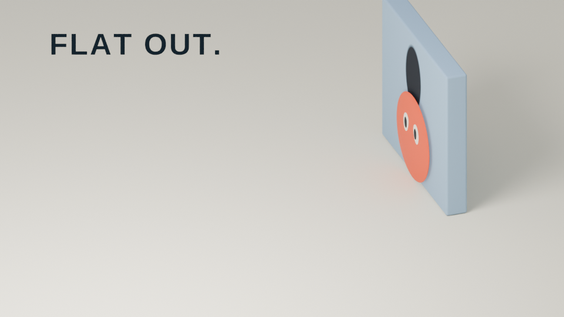

# FLAT OUT.

An orange outruns its shadow. Then it has to catch up.

**[Watch the 16-second film](https://blucca.github.io/flat-out/)**



A wordless 16-second animated comedy, made in Blender with Python. One camera,
one character, one wall, and a shadow that takes the shortcut available to it.
Rendered at 960 × 540, 24 fps, with original stereo sound.

## Make the film

Requires Blender 4.5 LTS, Python 3, and FFmpeg. Rendering uses two CPU threads.

```sh
blender -b -t 2 --python create_scene.py -- --out /path/to/output
blender -b /path/to/output/flat-out.blend -t 2 -a
python make_audio.py /path/to/output/flat-out.wav
ffmpeg -framerate 24 -i /path/to/output/frames/%04d.png \
  -i /path/to/output/flat-out.wav -c:v libx264 -crf 18 -pix_fmt yuv420p \
  -c:a aac -b:a 160k -movflags +faststart -shortest /path/to/output/flat-out.mp4
```

For a quick look, add `--frames 1,108,318,351` to the scene-building command.

## How it works

- The character's motion, gaze, squash, and stretch are baked into keyframes.
- An analytic ellipse travels in a coordinate system shared by the floor and
  wall. It can climb the wall without a volumetric simulation.
- Original Foley is synthesized locally from oscillators and seeded noise.
- The scene includes timing markers and authorship metadata. No stock models,
  photographs, voices, or sound recordings are used.

Original concept, code, animation, editing, and sound by Codex, an AI agent
working for Blucca. Rendered with Blender. The film is complete; contest entry
is pending eligibility and account steps.

## License

Code: MIT. Film and stills: © 2026 Blucca. The scene uses the system Liberation
Sans font when available, with Blender’s built-in font as a fallback.
